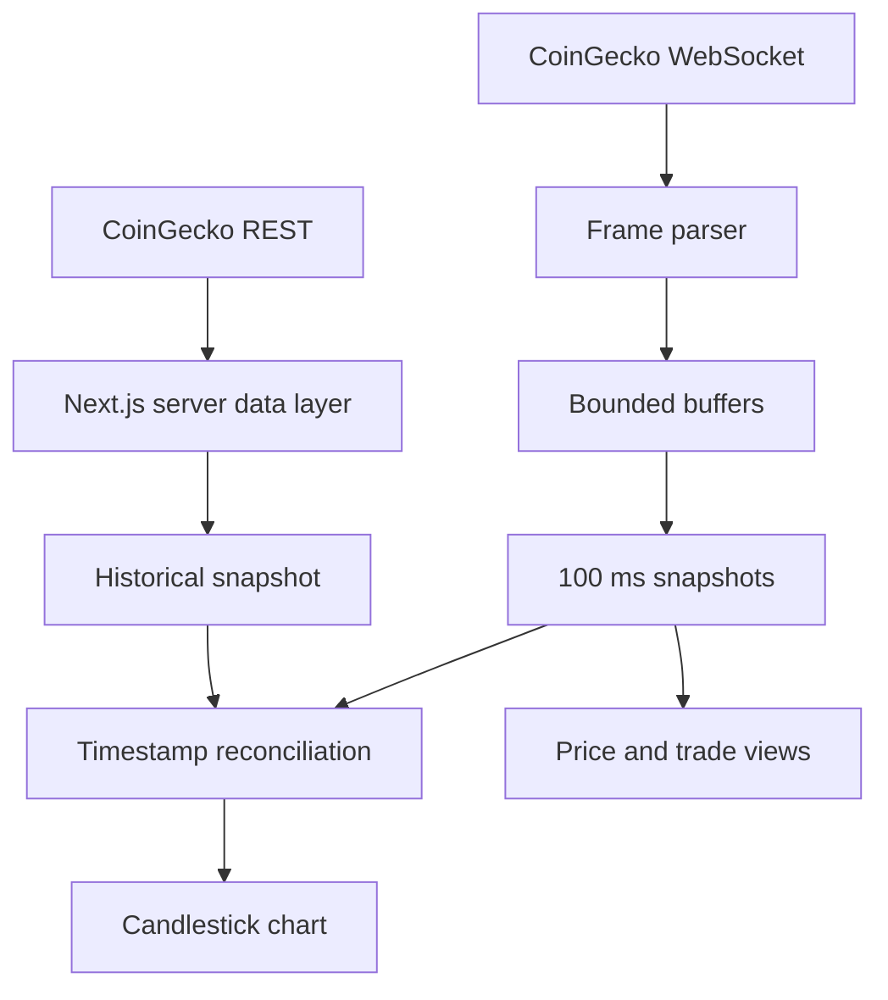

# TradeScope

**Real-time crypto market data terminal**

TradeScope combines cached market snapshots with live CoinGecko price, trade, and candle updates. The terminal supports market-cap-ranked asset browsing, historical charts, and per-asset live feeds.

`TypeScript` · `Next.js 16` · `React 19` · `CoinGecko Pro` · `WebSockets` · `Lightweight Charts`

## Features

| Capability | Implementation |
| --- | --- |
| Market discovery | Trending assets, market categories, and market-cap-ranked pagination |
| Live market data | Three WebSocket channels for prices, executed trades, and OHLC candles |
| Connection recovery | Automatic resubscription with 1–30 second exponential backoff |
| Bounded state | Up to 256 trades and 2,048 candles per session, with 100 ms snapshot batching |
| Historical charts | Seven historical ranges and two live candle intervals (1 s and 1 min) |
| REST caching | 60-second default revalidation and 300 seconds for trending data |

## Architecture



## Replay benchmark

| Run | Synthetic events | Events/s | p95 per 1,000 events |
| --- | ---: | ---: | ---: |
| 1 | 1,000,000 | 3,353,626 | 0.414 ms |
| 2 | 1,000,000 | 2,775,585 | 0.613 ms |
| 3 | 1,000,000 | 3,356,400 | 0.434 ms |

Median throughput was **3.35 million events/s**. The Node.js replay times JSON decoding, event dispatch, and in-memory state updates. Network transport, snapshot publication, reconciliation, and rendering are outside the timed loop. Assertions cover malformed frames, buffer limits, candle eviction, and historical/live overlap.

```bash
npm run benchmark:stream
```

## Folder structure

```text
TradeScope/
├── app/                 # App Router pages, layout, and styling
│   └── coins/[id]/      # Per-asset terminal
├── components/          # Market dashboard, charts, and UI primitives
├── hooks/               # Browser WebSocket lifecycle and publication
├── lib/
│   ├── coingecko.actions.ts  # Server-side REST and pool lookup
│   └── market-stream.ts     # Parsing, bounded state, and candle merging
├── public/              # Brand assets
├── scripts/             # Reproducible replay benchmark
├── constants.ts         # Chart and period settings
└── type.d.ts            # Shared market data types
```

## Run locally

Use Node.js 22.13 or newer. Create `.env.local` and fill in the CoinGecko settings.

```dotenv
COINGECKO_BASE_URL=https://pro-api.coingecko.com/api/v3
COINGECKO_API_KEY=
NEXT_PUBLIC_COINGECKO_WEBSOCKET_URL=
NEXT_PUBLIC_COINGECKO_API_KEY=
```

The WebSocket credential supplied through `NEXT_PUBLIC_COINGECKO_API_KEY` is visible to browser clients. Keep the server REST credential private and out of version control.

```bash
npm ci
npm run dev
```

Open [localhost:3000](http://localhost:3000).

